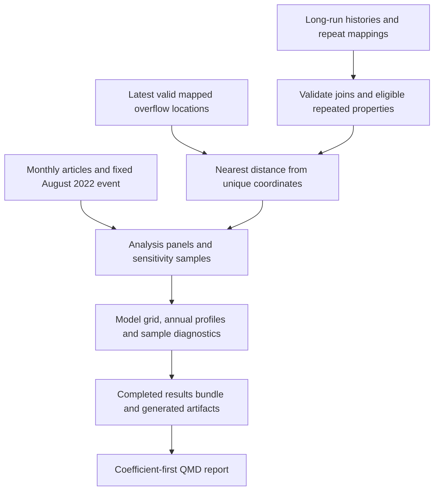
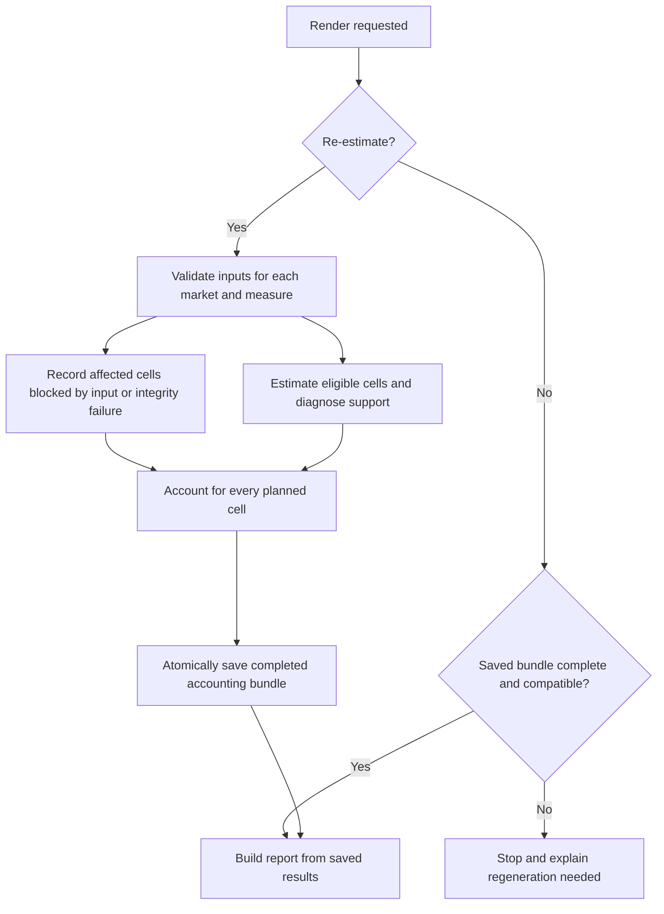

# Long-run public attention with repeat properties - Plan

## Goal Capsule

- **Objective:** Establish whether the same properties near mapped sewage overflows experienced different price changes from farther properties as national sewage attention increased, and show how sensitive that finding is to sample composition and local price trends.
- **Means:** One exploratory Quarto report extending the existing extensive-margin news analysis with repeat-property panels (R1, KTD1).
- **Authority:** The requirements below preserve the user's choices. Technical decisions govern implementation within those requirements; implementation units do not override either.
- **Execution profile:** This document plans future implementation. The current authorized deliverable is this plan on branch `jo/long-run-repeat-sales`; implementation requires a later instruction.
- **Stop conditions:** During implementation, stop the affected analysis if required inputs cannot be read, mapping integrity fails, or attention coverage cannot be established. Report unsupported model cells rather than substituting another sample or estimator silently (KTD7).
- **Completion and handoff:** The future implementer owns the report, regeneration checks and review through the Definition of Done. Publishing, committing, pushing and promoting the exploration into analysis scripts are separate instructions.

---

## Product Contract

### Summary

Create an exploratory report comparing long-run sale prices and asking rents near and farther from mapped overflows, using property fixed effects and the public-attention measures already used in the project.
Show data readiness, the headline estimates, earlier price-gap paths and sensitivity to observed characteristic changes.
Keep the first implementation in one QMD report under `docs/reports/`.

### Problem Frame

[Issue #14](https://github.com/sticerd-eee/sewage/issues/14) asks whether the public-attention analysis extends beyond the period with detailed spill records.
The long-run transaction histories and repeat mappings are available, but the existing extensive-margin scripts and distance lookups use the shorter study window.
Repeat-property models remove fixed property differences while changing the population to properties observed more than once.
They do not by themselves distinguish publicity from other changes in near–far relative desirability.

### Key Decisions

- **Use a report before production scripts.** The exploration should establish what is useful before promoting code. Governs R1. (session-settled: user-directed — chosen over immediate analysis-script implementation: inspect the exploratory report first.)
- **Use the available windows.** Governs R2. (session-settled: user-directed — chosen over adding 2013 sales: use 2014–2024 sales and the available rental history.)
- **Retain groups with recorded characteristic changes in the headline.** Governs R6. (session-settled: user-approved — chosen over excluding flagged groups by default: preserve the headline sample and assess changes separately.)

### Requirements

**Deliverable and population**

- R1. Produce one reproducible exploratory QMD at `docs/reports/2026-09-19-001-long-run-public-attention-repeat-properties.qmd`, with a rendered HTML report and generated analysis artifacts.
- R2. Use sales from January 2014 through December 2024 and rentals from January 2014 through December 2023, documenting actual coverage and every sample restriction.
- R3. Define exposure from overflow locations alone, without spill counts, spill hours or monitoring completeness entering treatment or sample eligibility.

**Analysis**

- R4. Estimate the repeat-property analogue of `scripts/R/09_analysis/05_news/`, retaining all eligible observations for properties observed on at least two distinct dates.
- R5. Present both agreed fixed-effect specifications and both attention measures, with uncertainty, sample sizes and a clear interpretation of each coefficient.
- R6. Retain observed characteristic-changing groups in the headline, then show whole-group exclusions and a complete-case comparison that separates the effect of sample attrition from adding controls.
- R7. Compare earlier annual near–far price-gap paths and the long-run results with a repeat-property sample starting in 2021, without presenting either exercise as proof of a publicity effect.

**Audit and presentation**

- R8. Regenerate readiness and sample diagnostics from the inputs, including mapping integrity, repeat support, exposure coverage, characteristic changes and final estimation support.
- R9. Lead the report with readable coefficient comparisons, then explain the design and provide full tables, sample accounting, limitations and source provenance.
- R10. Allow presentation-only regeneration from compatible saved results, and reject missing, stale or incomplete result bundles with an actionable explanation. Incomplete means missing required entries/metadata or interrupted serialization, not explicitly recorded blocked or unsupported model cells.

### Scope Boundaries

The report estimates changes in the near–far gap within the repeat-property population.
It does not establish historical overflow construction dates or identify publicity separately from every competing local change.
Continuous Google Trends before 2018, explicit Palmquist price-change pairs, spill-intensity regressions and nationwide all-pairs distance files are outside this exploration.

### Deferred to Follow-Up Work

Move useful, reviewed analysis into `scripts/R/09_analysis/` after inspecting the report.
Any upstream recleaning, repeat-address redesign, new shared helper abstraction, additional distance grid or new causal identification strategy needs a separate scope decision.
Usefulness means informative and reproducible results, including null or unstable estimates; statistical significance is not a promotion criterion.

### Acceptance Examples

- AE1. Covers R4/R8. A property with two history records but only one distinct date remaining after a model's restrictions contributes no identifying repeat observation; recompute eligibility rather than trusting stored `repeat_count`.
- AE2. Covers R6. A rental with one missing bathroom value and one observed value is not classified as changing bathrooms; two different observed values do trigger the exclusion sensitivity.
- AE3. Covers R3. An overflow first monitored after 2014 remains part of the fixed location projection; its monitor commissioning date does not censor earlier transactions.
- AE4. Covers R10. After a source input or analysis setting changes, a presentation-only render refuses the old bundle and identifies what needs re-estimation.

---

## Planning Contract

### Key Technical Decisions

- KTD1. **Transaction-level property fixed effects.** Replace the baseline location fixed effects with repeat-property effects; do not form explicit price-change pairs. The outcome is log sale price or log asking rent, with rental timing based on the existing `rented_est` construction. Verify the provider's weekly-rent definition and consistency across input vintages before treating these as comparable outcomes; the cleaner carries `listing_price` through without demonstrating unit conversion. Do not invent a conversion if units are unresolved. (session-settled: user-directed — chosen over explicit Palmquist-style pairs: use property fixed effects.) Governs R4.
- KTD2. **Freeze overflow locations.** Use the existing latest-valid location rule in `scripts/R/utils/site_group_utils.R` over the 2021–2024 Site Group crosswalk. Compute nearest distance in British National Grid metres from unique postcode-derived property coordinates to Site Group representative locations, using indexed matching or bounded chunks rather than a full coordinate-by-site matrix. Preserve columns required by the projection helper, including `annual_status` for structural validation; monitoring status must not become an eligibility restriction. This assumes mapped assets existed earlier; monitor commissioning is not asset creation. (session-settled: user-directed — chosen over allowing monitoring availability to determine historical exposure: assets likely predated their recording equipment.) Governs R3.
- KTD3. **Two fixed-effect specifications.** Fit property + calendar-month effects, and property + calendar-month + MSOA × year effects. In both, cluster standard errors by LSOA as in the extensive-margin news scripts. (session-settled: user-directed — chosen over selecting just one fixed-effect structure: compare both in the report.) Governs R5.
- KTD4. **Common January 2014 article stock.** Build a complete monthly calendar, cumulate the existing search-1 article counts from January 2014, and take the log of that stock. Exclude all earlier articles (207 in the prior audit) and use the same stock in the short-window comparison. Require positive initial stock; the audited January count of two is evidence, not a hard-coded requirement for refreshed data. Apply the coverage and count-validation contract below before filling absent months with zero. Unresolved coverage or logarithm support blocks article cells; it does not change valid Post or annual-profile analyses. Do not substitute `log1p`, an offset or a later origin. (session-settled: user-directed — chosen over retaining the pre-2014 initial stock: start in January 2014.) Governs R5/R7.
- KTD5. **Preserve the reference distance bands and event.** Near is 0–500 m inclusive; far is greater than 1,000 m and at most 2,000 m. Omit the intervening band. The post indicator starts in August 2022 inclusive, matching the current news scripts and slides. Set that date independently of calendar indexing: the current Google Trends helper couples its base year to a four-year peak-search window. Governs R3/R5.
- KTD6. **Apply the agreed characteristic sensitivity consistently.** Flag multiple distinct nonmissing values within each property's eligible long-run history before complete-case filtering. Sales flags use property type; rentals use type, bedrooms and bathrooms. Exclude whole flagged properties for the observed-change sensitivity. The complete-case comparison uses identical rows for no-control and controlled fits within each specification; controls are sales type/old-new/tenure and rental type/bedrooms/bathrooms. Governs R6; implements the labeled Key Decision governing R6.
- KTD7. **Make sample and estimation failures explicit.** Follow the ordered sample contract below, requiring finite positive outcomes, valid dates/coordinates and the geography identifiers needed for the common comparison panel. Recompute repeats after each sample restriction, then record rows actually retained by fixed-effect estimation. Distinguish blocked inputs, unidentified focal terms and estimated coefficients with unavailable inference; never replace missing estimates with zero. Record absorbed controls separately: their absorption need not invalidate the focal coefficient. Unexpected computation errors stop the run with context. Governs R4/R8.
- KTD8. **Keep estimation and result reuse inside the QMD.** Follow the existing report's `reestimate` pattern, with one bundle containing compact model objects, tidy results, diagnostics, realised attention calendar, fixed site projection, sample membership and run metadata, including R/package versions. Identify directly consumed inputs with content hashes or trustworthy immutable generation identifiers; paths, sizes, modification times and schemas are descriptive provenance, not sufficient content identity. Fingerprint computational QMD chunks, their transitive computational helper dependencies, computational package versions and canonical analysis settings. Exclude prose, display-only changes and the `reestimate` switch; record display dependencies separately. Validate the exact expected 40 scalar and four profile model keys and explicit statuses before atomically replacing the completed bundle. Completion means every cell is accounted for, not that every cell was estimable; input-blocked cells remain visibly blocked. An interrupted run must leave the previous valid bundle intact. Governs R1/R10.
- KTD9. **Follow existing report and output conventions.** Use `here::here`, R 4.6.0 through `rv`, column-pruned Arrow reads, native pipes, `fixest` and existing table-formatting helpers where compatible with HTML. Materialize Arrow vectors before mutable joins. Use a fresh R session with explicit helper imports, without calling upstream scripts' `main()` functions or relying on objects left in the global environment. Hold one market panel and one working fit at a time; extract actual observation IDs, inference and support before compacting saved models, and release working matrices after each fit. Store shared ID dictionaries/sample indices, not a full frame per model. Save RDS under `output/regs/long_run_public_attention/`, tables under `output/tables/long_run_public_attention/`, PDF figures under `output/figures/long_run_public_attention/`, and run logs under `output/log/long_run_public_attention/`. Governs R1/R9/R10.
- KTD10. **Validate mappings against current addresses.** Check uniqueness, string IDs, excluded-ID reconciliation and mapping-generation metadata. A successful ID join alone is insufficient because an address correction can leave a Land Registry transaction ID unchanged. On requested-window mapped candidates, including mapped singles, recompute the current normalized address key and its expected `repeat_id` read-only using the existing `build_address_key()`/`hash_serialized_values()` contract and exact market-specific field order. Missing current keys or mismatched repeat IDs stop that market. Explain generation discrepancies; do not rebuild, repair or publish mappings inside the QMD. Governs R4/R8.
- KTD11. **Measure remaining design variation and preserve inference conventions.** On each scalar fit's actual sample, residualise `Near × Attention` against every included fixed effect and control. Save residual sum of squares, its ratio to centred raw-regressor variation, annual and LSOA shares of squared residuals, and the largest cluster shares. These descriptive measures add no eligibility thresholds and are not causal weights or influence diagnostics. Use the fit's LSOA-clustered covariance, recorded small-sample settings and model-specific degrees of freedom consistently for pointwise 95% intervals and joint tests. Preserve convergence, collinearity and covariance warnings; invalid inference remains explicitly unavailable. Governs R5/R8.

### Ordered sample and source contracts

Apply requested dates, then validate current-address mappings under KTD10 before dropping mapped singles.
Check contradictory nonmissing country, coordinates and LSOA/MSOA values within these candidate groups before row-level geography exclusions can conceal contradictions; exclude contradictory groups with counts.
Then apply common outcome, England, projected-coordinate and LSOA/MSOA requirements, the fixed distance bands, and the requirement of at least two distinct surviving dates.
Freeze characteristic-change flags on this eligible long-run panel before complete-case or short-window restrictions.
For each variant, apply its restrictions and recompute repeats; account separately for subsequent estimator removals.
Two dates within one calendar month meet the agreed repeat criterion, although they need not supply distinct attention values.

For articles, require one valid row per observed year-month and finite nonnegative integer counts before joining to calendars of 132 sales months and 120 rental months.
Duplicate monthly keys and observed missing counts are input problems, not values to sum or replace with zero.
Record available search-period and export-completeness evidence, including reconciliation of export segments and extracted records where available.
The first/last observed article dates, `n()` aggregation and PDF cover pages alone do not establish completeness.
Only fill absent rows with zero inside established coverage of this fixed search corpus; this does not certify comprehensive or compositionally constant UK media coverage.

The July 2026 LexisNexis refinement plan documents off-topic matches and merged article boundaries with potentially misassigned metadata.
Inspect available export/extraction evidence and disclose these inherited measurement limitations; a readable monthly file is not certification of the corpus.
If usable monthly coverage cannot be established, record blocked article cells and continue eligible Post/profile analyses.
Do not repair the parser, redefine the corpus or perform relevance filtering in this report; that belongs to the separate LexisNexis workstream.

### Model and comparison design

For property i observed in calendar month m, estimate

\[
\log p_{im} = \alpha_i + \lambda_m
  + \beta\left(\mathrm{Near}_i A_m\right) + \varepsilon_{im},
\]

and the same equation with MSOA × year effects.
Property effects absorb fixed proximity and fixed property characteristics; calendar-month effects absorb the attention main effect.
These are unweighted transaction/listing-level FE projections, not equal-property averages: frequency, timing and residualised attention variation determine their implicit weighting.
Repeat groups are operational address matches, not verified immutable dwellings or independent rental episodes.
The post coefficient measures a change in the near–far log-price gap.
The article coefficient measures its change per log point of cumulative articles, not the effect of one additional article.
For a post-effect percentage translation use `100 * (exp(beta) - 1)` and describe the change in the conditional near/far price ratio, not an absolute fall in near-property prices; article translations must name the change in article stock being evaluated.
Article stock runs through the full recorded transfer/listing month and may include articles after the recorded observation or price-setting date; it is not strictly prior information.

The model grid has five sample/control variants, each estimated for two markets, two fixed-effect structures and two attention measures: 40 planned fits.
Annual profiles add four fits on the headline samples.
Unsupported cells remain visible in the grid.

| Variant | Sample | Controls | Purpose |
|:--|:--|:--|:--|
| Headline | Eligible long-run repeat properties | None | Main within-property comparison |
| Exclude observed changes | Headline less whole flagged groups, per KTD6 | None | Sensitivity to recorded changes |
| Complete-case comparator | Complete cases for the KTD6 controls, with repeats recomputed | None | Isolate complete-case selection |
| Complete cases with controls | Exactly the comparator's estimation rows within each FE specification | KTD6 controls | Isolate adding observed characteristics |
| Short window | 2021 through each market's end, with repeats recomputed | None | Compare the period used by existing news analysis |

The short-window comparison changes both dates and repeat-property membership.
Keep the KTD4 article stock so a change in its origin does not add another difference.
This does not reproduce the existing cross-sectional baseline, which uses a different sample and fixed effects.
Characteristic exclusions and controlled comparisons assess sensitivity; they do not prove that conversions, matching error or selection have been removed.
Differences in statistical significance do not establish differences between estimates.

### Assumptions and diagnostics

These are implementation defaults inferred from the current analysis conventions, rather than additional user-settled choices.

- **Population:** Explicitly select England and retain Greater London. The baseline news scripts provide the specification reference; their preparation code does not explicitly restrict England and does require complete controls even for uncontrolled fits. Do not inherit that selection or its latitude/longitude filters wholesale: the new headline retains missing characteristics and requires usable projected coordinates. Require common nonmissing LSOA/MSOA identifiers before comparing FE structures; disclose attrition and further model-specific removals.
- **Annual profiles:** Estimate Near × calendar-year coefficients relative to 2019 under both FE structures on the headline sample. Show pointwise intervals and the full joint test of the five 2014–2018 coefficients under KTD11. Check rank of the residualised annual-interaction matrix, availability of each requested contrast and validity of the covariance for the full restriction. Preserve available individual contrasts, but report the joint test as unavailable if its full restriction is unsupported. Display 2020–2021 as well; this earlier-period gap test is not a test of all pre-August-2022 observations or proof of parallel trends. The 2022 annual estimate mixes pre- and post-event months.
- **Spatial precision:** The audit found no coordinate changes within inspected repeat groups. Because postcode is part of the address key, this is a construction check, not independent verification of dwelling identity. Report the postcode lookup source/vintage (currently `2602_uk_postcodes.csv`), 2011 LSOA/MSOA labels, available coordinate-quality distribution, and unique-coordinate counts relative to property counts. Postcode-to-Site-Group distances can misclassify dwellings around band boundaries. “Far” refers to usable mapped representatives, not verified absence of a closer unmapped overflow; a small omitted-site count does not bound classification error.
- **Observation diagnostics:** Summarise observations per repeat group, inter-observation gaps, same-month repeats, outcomes/extreme changes and rental `rented_est` fallback shares by year and band. Reuse the existing large-group (>12 observations) and annualised price-ratio (>4 or <1/4) definitions as descriptive flags, reconciling their source generation or recomputing them on the eligible panel. Very short gaps can amplify annualised ratios. These diagnostics do not introduce aggregation, trimming, pair estimation or new headline exclusions.
- **Identification and inference:** Publicity-specific interpretation needs the absence of competing changes in near–far relative desirability. Property effects, local time effects and earlier profiles inform that assessment but do not establish it. LSOA clustering allows within-LSOA dependence, not arbitrary cross-LSOA dependence. Calendar-month effects do not remove national shocks with different near and far effects. KTD11 diagnoses the amount and concentration of residual variation without declaring causal identification or adequate inference from sample size alone.

### High-Level Technical Design

### Readiness and remaining uncertainty

The audit on 19 September 2026 found the core inputs readable, with the requested sales coverage and a usable rental history.
No observed data-access blocker remains.
Existing distance lookups are insufficient for the long-run population, but the necessary property coordinates and mapped overflow locations are available.
The future report must regenerate the diagnostics: the audited counts in the Appendix are evidence of feasibility, not hard-coded expected sample sizes.

Current address-to-mapping coherence, complete article coverage/extraction evidence and consistent rental units remain source-validation requirements, not demonstrated failures.
Final England rental support, fixed-effect pruning, residual design variation, annual-contrast availability, peak memory, runtime, effect sizes and confidence intervals remain implementation-time results.
The plan does not claim these have been measured.
Because `data/` and `output/` resolve to Dropbox storage, an implementation environment must permit writing the planned output artifacts.
Raw and processed source inputs remain read-only.

---

## Implementation Units

### U1. Establish the report's input and repeat-panel contract

**Goal:** Make input availability and repeat eligibility auditable before estimation.

**Requirements:** R1, R2, R4, R8; KTD1, KTD7, KTD9, KTD10.

**Dependencies:** None.

**Files:** Create `docs/reports/2026-09-19-001-long-run-public-attention-repeat-properties.qmd`; its input-validation and fixture-check chunks are also the verification location.

**Approach:**

1. Add report parameters, narrow input reads and provenance capture using the existing report pattern.
2. Validate mapping uniqueness, one-to-one joins, excluded source IDs, current-address consistency and generation metadata under KTD10. Confirm rental price units and date provenance.
3. Follow the ordered sample contract and build exclusion counts by market, year and repeat group; preserve IDs as strings. Produce observation-frequency, gap, outcome and rental-date diagnostics without new exclusions.

**Patterns to follow:** `scripts/R/utils/repeat_transactions_utils.R`, `scripts/R/testing/test_repeat_transactions_contracts.R`, and `docs/reports/2026-09-03-003-heterogeneity-by-salience-report.qmd`.

**Test scenarios:**

- Covers AE1. A restriction leaves one observation date; the property drops from that sample's repeat panel.
- A mapping contains a duplicated transaction ID or an ID absent from history; validation fails without multiplying or silently discarding rows.
- A corrected current address retains its transaction ID but changes the expected repeat ID; read-only verification catches the stale mapping, including on a mapped singleton, without rebuilding it.
- Contradictory nonmissing geography is detected before a row restriction could hide it; missing-to-observed geography alone is not a contradiction.
- Same-day conflicts and unkeyed sales exclusions reconcile with source history and mapping metadata.
- A required input is unreadable or a requested year has no observations; the report identifies the file/year and stops the affected analysis.

**Verification:** The QMD produces coverage and exclusion diagnostics from both real histories, with current-address consistency, accounting identities and distinct-date checks passing. Unresolved rental units or other required inputs produce an explicit affected-market diagnosis, not a speculative conversion.

### U2. Assign fixed proximity and calendar attention

**Goal:** Assemble the location-only exposure and attention variables without truncating early years.

**Requirements:** R3, R5, R8; KTD2, KTD4, KTD5.

**Dependencies:** U1.

**Files:** Add exposure, calendar and verification chunks to `docs/reports/2026-09-19-001-long-run-public-attention-repeat-properties.qmd`.

**Approach:**

1. Reuse the existing latest-valid Site Group projection and join nearest distances through unique coordinates using bounded memory under KTD2. Report spatial precision/vintage and unusable sites.
2. Apply the KTD5 bands and create the complete attention calendar through each market's final month, validating counts and recording the evidence used to distinguish zero months from unknown coverage.
3. Report excluded locations, coverage gaps, near/far counts and characteristic-change prevalence before model fitting. Save the realised site projection and calendar. For validated article inputs, plot monthly counts and log cumulative stock with August 2022 marked; otherwise show a coverage/input diagnosis in place of an unvalidated plot.

**Patterns to follow:** `scripts/R/utils/site_group_utils.R`, `scripts/R/09_analysis/05_news/extensive_margin_news_utils.R`, and `scripts/R/02_data_cleaning/clean_lexis_nexis_search1.R`.

**Test scenarios:**

- Distances of 500, 1,000 and 2,000 metres receive the KTD5 assignments exactly; compare nearest matching against exhaustive distances in a tiny geometry fixture.
- Covers AE3. Changing a monitor commissioning year leaves fixed exposure unchanged.
- A site with no valid coordinates is counted and omitted; zero usable sites stop matching.
- A zero-article month within verified coverage carries the prior stock forward; unknown coverage fails rather than becoming zero.
- Duplicate source month keys, observed missing counts, negative/noninteger counts or an invalid month fail article-input validation; missing export evidence is not replaced by minimum/maximum observed dates.
- In a fixture, January 2014 starts with two articles; the real input may have a different valid positive count. Zero initial stock blocks article models without changing the transformation or origin.
- July 2022 is pre-event and August 2022 is post-event; earlier months do not disappear through the old helper's indexing defaults.
- Article coverage failure leaves explicit blocked article cells while eligible Post/profile analyses can continue.

**Verification:** Every retained observation has one fixed exposure and one calendar match, with correct boundaries and market-specific end dates. Article values are populated only when the stated count and coverage checks pass.

### U3. Estimate the model grid and sensitivity comparisons

**Goal:** Produce interpretable estimates and comparable sample diagnostics for every planned cell.

**Requirements:** R4, R5, R6, R7, R8; KTD1, KTD3, KTD6, KTD7, KTD9, KTD11.

**Dependencies:** U2.

**Files:** Add modeling, result extraction and model-check chunks to `docs/reports/2026-09-19-001-long-run-public-attention-repeat-properties.qmd`.

**Approach:**

1. Construct the five variants in the model grid and the annual-profile samples.
2. Estimate sequentially, capturing retained IDs, cluster counts and KTD11 residual support before compaction. A fit made lean too early loses information needed for these checks. FE-demeaned RHS columns may be used, with a rank-aware projection against the remaining controls for controlled fits; FE demeaning alone is insufficient there. Then retain compact results and release each working fit's matrices.
3. Extract coefficients, pointwise intervals, joint tests, numerical warnings and model statuses through the consistent KTD11 inference path. Report retained near/far properties and properties observed on both sides of August 2022 alongside residual-support diagnostics. Neither raw count establishes identification, and no rule requires every property to cross the event or every MSOA-year to contain both bands.

**Patterns to follow:** `scripts/R/09_analysis/05_news/did_trends_prior_extensive.R`, `scripts/R/09_analysis/05_news/did_articles_prior_extensive.R`, and the model/report pattern in the salience QMD.

**Test scenarios:**

- Covers AE2. Missing-to-observed values do not flag a change, but two different nonmissing values exclude the whole group in the corresponding sensitivity.
- Complete-case controlled and no-control fits retain identical transaction IDs within each FE specification; differences must be resolved before comparison.
- A small constructed panel with a known near–post change recovers that coefficient with both FE structures when sufficient within-area support exists.
- A sample with no usable treatment contrast or a collinear focal term yields an unsupported status with its cause, not an estimate of zero.
- A constructed sample with abundant raw near/far observations but focal variation absorbed by the full FE structure is diagnosed correctly. A concentrated but estimable contrast is reported descriptively without an invented cutoff or exclusion.
- Absorbed controls do not automatically invalidate an identified focal coefficient; unavailable covariance/inference is distinguished from an unidentified coefficient. Intervals and joint tests use the same recorded covariance and degrees-of-freedom conventions.
- Short-window eligibility is recomputed, while its article values equal those for the same months in the long-run calendar.
- Annual profiles omit 2019 as the reference and use the stated early-year restriction for the joint test. If any required coefficient or the joint covariance is unavailable, report the full test as unavailable rather than testing a reduced set; retain other estimable individual contrasts.

**Verification:** Each of the 40 grid cells and four annual profiles has estimates or a specific input/support diagnosis, with inference availability recorded separately; final IDs, rows, properties and clusters reconcile to each model. Residual-support summaries accompany identified scalar estimates, and annual restrictions are checked in full.

### U4. Produce and verify the reproducible report

**Goal:** Let the researcher inspect the results and regenerate presentation without repeating estimation.

**Requirements:** R1, R8, R9, R10; KTD8, KTD9.

**Dependencies:** U3.

**Files:** Complete `docs/reports/2026-09-19-001-long-run-public-attention-repeat-properties.qmd`, including saved-result validation and rendering checks. Generated HTML and `output/` artifacts are build products, not additional source files.

**Approach:**

1. Validate exact model keys/statuses and atomically save the completed KTD8 bundle and generated tables/figures under KTD9, binding each artifact to its run metadata.
2. Build a concise findings section from fitted objects, with separate sales/rental estimates and visible uncertainty.
3. Add sample flows, residual-support summaries, the validated attention-history plot or blocked-input explanation, the repeat-data cleaning explanation in the Appendix, equations, native HTML tables and measurement/identification limitations; implement the KTD8 reuse path. Do not copy a LaTeX-only formatter into the HTML output.
4. Review the rendered HTML and exported figures, then verify a presentation-only render against the original run.

**Patterns to follow:** `docs/solutions/design-patterns/analysis-results-static-html-reports.md`, `docs/solutions/design-patterns/output-specific-research-figure-sizing-and-verification.md`, `scripts/R/09_analysis/utils_table_formatting.R`.

**Test scenarios:**

- Covers AE4. Changed input content, a computational helper or analysis settings invalidate the bundle, including input replacement that preserves size/mtime. Prose/display-only edits and toggling `reestimate` permit reuse when computational dependencies are unchanged.
- A missing or partial bundle fails with a regeneration instruction and does not appear as current results.
- A duplicated model key plus a missing expected key fails even if the total count is 44; an interrupted save leaves the preceding valid bundle intact.
- A complete accounting bundle with explicitly blocked article cells renders valid Post/profile results and the article-input diagnosis, without presenting an unvalidated attention plot.
- The cached render reproduces estimates, sample counts and model statuses without executing matching or regression chunks.
- Unsupported cells remain visible in tables and captions; plotting does not silently drop them from the stated comparison.
- Rendered tables, equations, labels and PDF figures are readable, with no clipped content or misleading common scale across differently interpreted coefficients.

**Verification:** Both estimation and cached render paths complete, artifacts agree with saved model results, and a visual review finds no material presentation defects.

---

## Verification Contract

Verification belongs to future implementation; no regressions, tests or data rebuilds are authorized by the present plan-only request.
Use the project R 4.6.0 environment managed by `rv` and render the target QMD with Quarto.
Keep lightweight fixture checks inside the QMD so the exploration remains a single source artifact; no new testing framework or standalone analysis scripts are required.

The implementation gate combines the U1–U3 fixture scenarios with real-input accounting and the U4 estimation/cached-render comparison.
Inspect an actual rendered coefficient plot, full model table and exported PDF figure.
Review the R code against project conventions and check that the statistical interpretation matches the model actually fitted.
Do not run unrelated pipeline rebuilds or broaden testing after these checks pass without a specific unresolved concern.

---

## Definition of Done

- The single QMD implements R1–R10, and each implementation unit satisfies its verification outcome.
- Data-readiness evidence and all sample counts are computed by the report, including current-address mapping checks, source-coverage provenance and final residual support rather than only pre-estimation diagnostics.
- All planned model cells and annual profiles are accounted for, with honest uncertainty and unsupported statuses where needed.
- Complete-case comparisons use identical estimation observations within each FE specification, and the report distinguishes sample effects from added controls.
- Results regenerate from the saved compatible bundle, and presentation matches the stored estimates.
- Raw and processed source data are unchanged; no exploratory code has been promoted into `scripts/R/09_analysis/`.
- Abandoned code, scratch dependencies and unused artifacts introduced during implementation are removed from the deliverable.

---

## Appendix

### Existing readiness evidence

These measurements were collected before the plan-only instruction.
They establish feasibility and answer the cleaning question; they are not estimates from the proposed regressions.

| Input | Observed evidence | Remaining report work |
|:--|:--|:--|
| `data/processed/house_price_long_run.parquet` | 11,207,136 rows; 2014-01-01 to 2024-12-31; unique nonmissing IDs; no missing dates or nonpositive/missing prices | Apply England and model sample rules |
| `data/processed/zoopla/zoopla_rentals_long_run.parquet` | 5,483,171 rows covering 2014–2023; all IDs join the rental mapping | Confirm units, date provenance and final England outcome support |
| `data/processed/repeated_transactions/repeated_sales.parquet` | 11,068,790 unique mapped IDs, all found in history; 4,010,615 repeat observations in 1,861,864 groups | Verify current-address consistency and recompute repeats after restrictions |
| `data/processed/repeated_transactions/repeated_rentals.parquet` | 5,483,171 unique mapped IDs; 4,104,097 repeat observations in 1,379,332 groups | Verify current-address consistency and model-specific support |
| `data/processed/matched_events_annual_data/site_group_crosswalk.parquet` | 13,990 groups over 2021–2024; latest-valid projection has 13,969 usable locations and 21 missing | Regenerate fixed proximity diagnostics |
| Existing site–transaction lookups | Built from study-window inputs; sales has 272,728,062 pair rows and rentals 111,923,121 | Avoid these large incomplete-for-purpose joins |
| `data/raw/google_trends/google_trends_uk.xlsx` | UK sheet covers January 2018–December 2024; peak August 2022 | Use the fixed event, not a continuous pre-2018 series |
| `data/processed/lexis_nexis/search1_monthly.parquet` | Positive-count months from March 1989 to July 2025; two articles in January 2014; 207 before 2014 | Establish fixed-corpus coverage/extraction provenance, disclose known limitations and complete the calendar only where justified |

Both mappings reconcile repeat counts and have no repeated dates among repeat properties.
The sales mapping's recorded source modification time matches the history file.
These join/count/metadata checks do not yet establish consistency with every current normalized address.
Initially cloud-only inputs became readable during the audit; no remaining cloud-read blocker was observed.
The rental outcome is a listing-price measure, and its date is `rented_est = coalesce(rented, latest_to_rent)`; neither establishes agreed rent or an exact tenancy start.

### What improved cleaning resolved

The same-day sales fix removed 102,699 observations in 50,327 address–date conflicts.
Together with 35,647 unkeyed observations, these reconcile the 138,346 history rows absent from the mapping.
On the same input, the fix reduced groups with multiple observed property types from 90,073 to 77,319, a 14.2% reduction.
Other changes introduced content-stable IDs, rejected duplicate Land Registry transaction IDs and removed 11,941 exact duplicate rental rows.

Across-date characteristic changes remain intentional diagnostics, not automatic exclusions.
`scripts/R/testing/test_repeat_transactions_contracts.R` explicitly preserves mixed-type groups.
Flags cannot distinguish real conversions, inconsistent classification and wrong address matches.

| Observed change | Flagged repeat properties | All repeat properties | Share |
|:--|--:|--:|--:|
| Sales property type | 77,319 | 1,861,864 | 4.15% |
| Rental property type | 81,056 | 1,379,332 | 5.88% |
| Rental bedrooms | 109,500 | 1,379,332 | 7.94% |
| Rental bathrooms | 74,416 | 1,379,332 | 5.40% |
| Rental any of these | 213,822 | 1,379,332 | 15.50% |

The flagged sales groups contain 173,782 observations, or 4.33% of repeat transactions.
Of those groups, 66,376 include the `Other` category, accounting for 85.85% of flags.
There are 11,483 groups with multiple specific residential codes, including groups also containing `Other`: 0.62% of all sales repeats.
This suggests a classification component without proving the cause.

The flagged rental groups contain 757,515 observations, or 18.46% of repeat listings.
Among rental repeat observations, 11.08% lack type, 3.20% lack bedrooms and 28.73% lack bathrooms.
A further 420,619 properties have missing-to-observed differences without an observed characteristic change; missingness must therefore remain separate from the change flags.

The England sales near/far diagnostic has 885,436 repeat properties and 1,909,398 transactions.
Type changes affect 4.26% of near properties and 3.97% of far properties, or 4.09% combined.
The rental distance-band diagnostic has 656,599 properties and 1,944,628 observations; any characteristic change affects 14.02% near and 15.59% far, or 14.97% combined.
Rental geography counts precede explicit country, outcome, control and FE-support restrictions; neither diagnostic is the final regression sample.

### Research pointers

- `scripts/R/02_data_cleaning/clean_lr_house_price_data.R` and `clean_zoopla_data.R`: coverage, outcome construction and retained characteristics.
- `scripts/R/06_analysis_datasets/repeat_sales.R`, `repeat_rentals.R`, and `scripts/R/utils/repeat_transactions_utils.R`: address keys, same-day exclusions, stable string IDs and mappings that include singles.
- `docs/adr/0002-content-stable-transaction-identity.md`: transaction identity contract.
- `scripts/R/utils/hash_utils.R`: existing address-key hashing for read-only mapping validation.
- `scripts/R/utils/postcode_processing_utils.R`: postcode coordinate precision, quality and geography vintage.
- `docs/adr/0001-canonical-spill-sites-and-site-groups.md` and `scripts/R/utils/site_group_utils.R`: mapped-site meaning and latest-valid projection.
- `scripts/R/04_feature_engineering/site_house_sale_match.R` and `site_rental_match.R`: study-window limitation of existing lookups.
- `scripts/R/02_data_cleaning/clean_lexis_nexis_search1.R` and `nexis_pdf_conversion.R`: observed-article extraction and monthly aggregation; neither supplies a coverage manifest.
- `docs/plans/2026-07-01-001-feat-lexisnexis-llm-relevance-geotag-ra-issue.md`: documented article relevance/extraction limitations and the separate remediation workstream.
- `docs/solutions/developer-experience/exploratory-extensive-margin-news-notebook-render-stabilisation-20260319.md`: memory-aware reads, sequential fitting and current modeling interfaces.
- `docs/solutions/developer-experience/exploratory-extensive-margin-news-notebook-plot-first-comparison-refactor-20260319.md`: plot-first comparisons with audit tables.
- `docs/solutions/logic-errors/arrow-altrep-data-table-join-nondeterminism.md`: materialize Arrow vectors before mutable joins.
- User-supplied Overleaf `short_pres.tex`, slide “Does national public attention to sewage widen the near–far price gap?”, and `_main.tex` / `04_causal_impacts.tex`: extensive-margin specification and information-shock motivation. These contextual documents are not execution dependencies.
