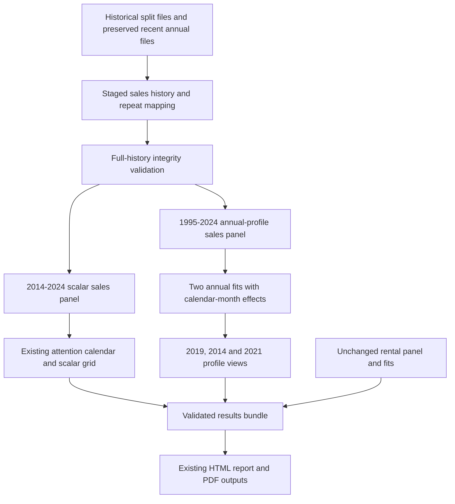
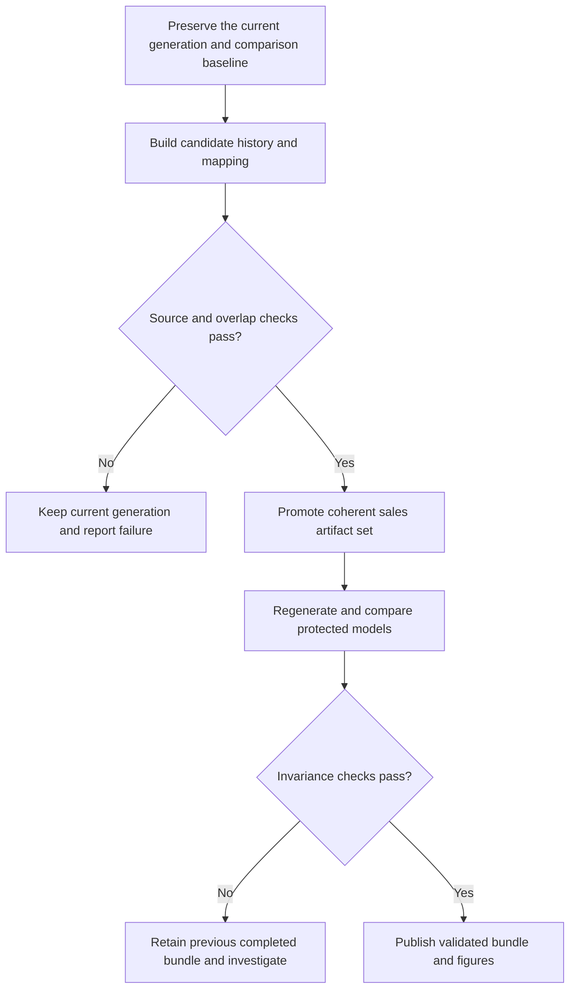

# Sales annual price profiles from 1995 - Plan

## Goal Capsule

- **Objective:** Let readers inspect how the near–far sale-price gap evolved from 1995 through 2024.
- **Means:** Extend the existing Annual Near–Far Price Profiles through a separate sales profile panel (KTD1), using the existing estimator and display contrasts (KTD4).
- **Authority:** Product requirements govern outcomes; KTDs govern implementation within those requirements; implementation units override neither. This amendment supersedes the parent plan only where its sales profile window and upstream sales-history boundary conflict with R1 and R9.
- **Execution profile:** The current authorization is planning only. Code changes, data regeneration and rendering require a subsequent implementation instruction.
- **Stop conditions:** Stop the affected extension if the historical inputs fail validation, overlap values change unexpectedly or protected regression results fail the invariance checks (KTD2, KTD3, KTD6). Report unsupported annual contrasts explicitly under R7.
- **Completion and handoff:** The future implementer owns source validation, targeted changes, regeneration, comparison evidence and report verification through the Definition of Done. Committing, pushing and publishing require separate instructions.

---

## Product Contract

### Summary

Extend the sales panels in the existing report's three annual-profile figures to 1995–2024. Retain the existing methods and reference years, and preserve the other regression results and rental profiles.

### Problem Frame

The current annual figures begin in 2014, although earlier sales files exist locally. This hides the longer history of relative prices that prompted the request. Extending the report's global sales window would also change attention regressions the user wants to preserve.

### Key Decisions

- **Extend the descriptive profiles only.** Governs R1, R2. (session-settled: user-directed — chosen over extending attention regressions too: the user wants earlier history for the event-study-like figures only.)
- **Retain the established proximity method.** Governs R4. (session-settled: user-directed — chosen over reconstructing historical asset existence: follow the method already used for 2014–2020.)
- **Determine profile eligibility over the expanded window.** Governs R1, R4. (session-settled: user-approved — chosen over restricting to existing repeat properties: use every property with two eligible dates in the longer history.)
- **Replace the existing sales panels.** Governs R5. (session-settled: user-approved — chosen over adding a parallel figure family: extend the views already in the report.)
- **Keep all three reference years.** Governs R5. (session-settled: user-directed — chosen over adding a 1995 reference: retain the existing comparison years.)

### Requirements

**Samples and methods**

- R1. Sales annual profiles use January 1995–December 2024, with repeat eligibility determined within that window; rentals retain January 2014–December 2023.
- R2. All 40 scalar attention-regression cells retain their existing samples, characteristic-change flags, transformations, controls, specifications and inference, including the 2021-on comparison.
- R3. The two sales profiles retain property + calendar-month effects and property + calendar-month + MSOA × year effects, with LSOA clustering and pointwise 95% intervals.
- R4. Preserve the existing sample and exposure rules: England including Greater London, address-key identity, same-day conflict exclusions, required geography, near [0, 500] m and far (1,000, 2,000] m, and distinct-date repeat/support checks after restrictions.

**Report and reproducibility**

- R5. Replace the sales panels in the existing 2019-, 2014- and 2021-reference figures with expanded profiles; retain the rental panels and the existing descriptive interpretation.
- R6. Preserve the joint restriction of 2014–2018 relative to 2019, recomputing the sales test on the expanded profile sample while preserving the rental tests.
- R7. Report actual coverage and support separately for profiles and scalar regressions, with explicit blocked or unsupported statuses.
- R8. Retain fresh estimation, validated cached rendering, full-covariance reference transformations and atomic bundle replacement.
- R9. Extend the upstream sales history and mapping while preserving existing cleaned overlap values, transaction identities, repeat identities and the 2021–2024 study data.

### Acceptance Examples

- AE1. Covers R1, R2, R4. A property sold only in 1998 and 2023 enters the expanded profile sample, but not the 2014-on scalar sample.
- AE2. Covers R1, R2. A property sold in 1998, 2015 and 2023 contributes three dates to profiles and only the two recent dates to scalar regressions; a type change confined to 1998 does not change the scalar observed-change flag.
- AE3. Covers R1, R3. A 1995 sale receives a calendar-month fixed effect without requiring an article record or a pre-2014 article stock.
- AE4. Covers R5, R8. Fresh and validated cached renders produce all three figures from the same expanded sales coefficients and covariance; the reference point remains a normalization.
- AE5. Covers R8, R9. An overlap mismatch prevents promotion of the candidate data; a failed bundle write leaves the previous completed bundle intact.

### Scope Boundaries

The parent plan, `docs/plans/2026-09-19-001-long-run-public-attention-design.md`, continues to govern unchanged analyses and the 20 September display extension. This amendment adds no estimator, historical asset reconstruction, article-series extension, expanded joint-test restriction, new reference-year figure or new sample sensitivity. Annual profiles remain descriptive conditional price paths.

### Deferred to Follow-Up Work

Promotion into production analysis scripts, changes to the other regressions and any refresh of existing raw sales vintages require separate scope decisions. The future glossary amendment describes implemented coverage; this planning task does not change the live glossary.

Product Contract preservation: restructured without scope change; the previous numbered requirements 1–8 retain their intent as R1–R8, and the existing upstream overlap commitment is recorded as R9. U1–U5 retain their identities.

---

## Planning Contract

### Key Technical Decisions

- KTD1. **Separate windows before repeat selection.** Keep the scalar configuration unchanged and add a profile-specific sales window, reusing the existing preparation functions with explicit configuration. Validate the full history and mapping manifest before window selection; keep retained-row dictionaries scoped to their panel. This prevents older observations changing R2 while enabling R1 and R7.
- KTD2. **Select sources explicitly by year.** Use both historical parts for 1995–2013 and the exact currently consumed complete annual files for 2014–2024. Check schema, per-file year bounds, unique source IDs and available provenance; never double-count overlapping complete and split inputs. Missing or inconsistent evidence blocks the affected source, without refreshing recent data. Governs R9.
- KTD3. **Stage and compare before promotion.** Preserve the baseline, build candidate sales history and mapping generations, and require equality of overlap values and identities after sorting by stable ID. Full-history repeat counts and generation metadata may change. Promote the validated sales artifact set only after these checks; preserve a recoverable previous set and prevent report reads of mixed generations. Governs R2, R9.
- KTD4. **Refit once, transform display references.** Re-estimate the two sales profiles with reference 2019, then derive 2014 and 2021 contrasts using the full covariance and existing degrees of freedom. Keep the article calendar out of profile preparation and allow calendar-month indices before January 2014. Governs R3, R5, R6, R8.
- KTD5. **Evolve the existing bundle.** Retain 40 scalar keys and four profile keys, adding separate panel membership and readiness metadata rather than introducing an independent cache. Increment the bundle version for the new shape and fingerprint both windows and all consumed sources. Governs R7, R8.
- KTD6. **Prove the preserved results.** Require exact equality of protected row IDs, flags, statuses, counts and settings; compare scalar estimates and inference plus rental profiles and covariance at tolerance `1e-8`. Earlier sales-profile coefficients may change. A mismatch requires diagnosis rather than weakening the threshold. Governs R2, R5, R9.

### High-Level Technical Design

Candidate promotion follows the validation boundary below. No new concurrent publication service is required; regeneration is a controlled batch operation.

### Research and Patterns

These facts were established by reading the current code and listing local files; the earlier raw files have not yet been audited or processed.

- `scripts/R/02_data_cleaning/clean_lr_house_price_data.R` fixes `LR_EXPECTED_YEARS` at `2014:2024`, accepts exact `pp-YYYY.csv` files and builds paired long-run and 2021–2024 study candidates. It derives transaction IDs from source identity and uses the existing local ONS postcode lookup.
- `data/raw/lr_house_price/` contains `pp-1995-part1.csv` and `part2` through 2013, split files for 2014–2017, and the complete annual `pp-2014.csv` through `pp-2024.csv` inputs used by the current cleaner. File presence does not establish completeness or download vintage.
- `scripts/R/06_analysis_datasets/repeat_sales.R` fixes its accepted range at 2014–2024. Repeat IDs derive from normalized address keys; recorded repeat counts describe the full upstream history.
- In the QMD, `estimate_market_models()` passes the same panel to the scalar grid and annual profiles. Separating the profile window is therefore necessary; changing `CONFIG$sales$start` globally would violate the requested scope.
- Calendar-month indexing currently uses the 2014 article origin, and `attach_attention()` requires all panel months to occur in the attention calendar. Annual profiles must be able to use earlier months without an article-calendar join.
- Original and alternative-reference plotting helpers contain fixed 2014–2024 axis settings. The report also calls 2014 the beginning of the observed sample.
- `scripts/R/testing/test_long_run_profile_references.R` already checks alternative-reference contrasts against independent refits under both fixed-effect specifications.
- `CONCEPTS.md` defines Long-Run Transaction History as beginning in 2014 for both markets. That definition will need a market-specific amendment when the expanded history is implemented.
- `data/` and `output/` are symlinks to the project's Dropbox storage. Future execution must use the actual filesystem permissions for those targets; this plan writes neither.

The existing local patterns are sufficient for this extension; no library selection or new statistical method is needed. Preserve materialized Arrow-to-data.table conversions per `docs/solutions/logic-errors/arrow-altrep-data-table-join-nondeterminism.md`. Preserve postcode-only enrichment per `docs/solutions/best-practices/lr-house-price-local-ons-postcode-lookup-20260310.md`; its historical code examples do not override the current stable-ID implementation.

### System-Wide Impact and Deferred Evidence

The canonical sales mapping is shared with `scripts/R/09_analysis/03_repeat_sales/repeat_sales.R`, which joins the study-window sales table and regroups. Verify its joined membership remains unchanged under R9; this plan does not rerun or redesign that analysis. Inventory other direct consumers before promotion, especially any consumer that trusts full-history `repeat_count` without regrouping.

Source-file completeness, historical coverage, expanded group diagnostics, fit support and memory use require implementation-time validation. Their checks are specified below; they are not claims established by this plan. Read full-generation identity columns for manifest checks but prune other columns and process one market/panel and fit at a time. Do not weaken integrity checks or enlarge the refactor to address a runtime problem without evidence.

---

## Implementation Units

### U1. Preserve a baseline and validate the earlier raw inputs

**Goal:** Establish the historical source contract and the evidence needed to enforce unchanged results.

**Requirements:** R2, R9; KTD2, KTD3, KTD6.

**Dependencies:** None.

**Files:** `scripts/R/02_data_cleaning/clean_lr_house_price_data.R`; `scripts/R/testing/test_cleaning_rebuild_contracts.R`; new `scripts/R/testing/verify_sales_profile_extension.R` for source/overlap and baseline comparison evidence.

**Patterns to follow:** Exact-file validation in `validate_expected_lr_files()` and existing cleaning manifest/checksum reports. Keep the verification script read-only with respect to canonical data.

**Execution note:** Capture the valid baseline before changing computational fingerprints or replacing input artifacts.

**Approach:**

Before replacing any generated artifact, preserve the current valid bundle and a comparison record outside paths overwritten by regeneration. Record current input fingerprints, scalar model statuses and formulas, retained transaction IDs, repeat IDs, characteristic-change flags, coefficients, standard errors, confidence intervals and sample counts. Preserve rental profile estimates, full covariance and joint tests as well. Capture the current cleaned 2014–2024 sales overlap and the 2021–2024 study table for identity checks.

Build an explicit year-to-source manifest:

- For 1995–2013, inspect both existing split files, their schemas, date ranges, transaction IDs and available provenance. Establish that each pair is a complete annual source, rather than infer that from filenames alone.
- For 2014–2024, retain the exact complete annual files currently consumed. Never concatenate the overlapping split files for 2014–2017 with those complete files.
- Validate all years, parseable dates, expected schema and globally unique source transaction IDs. Report year-level source and cleaning counts, including PPD category and property-type composition, to expose historical coverage differences without adding new sample restrictions.
- Preserve raw files. Record the actual source identities and provenance; do not describe the combined historical archive as a single-download vintage unless verified.

The existing cleaner explicitly assumes a same-vintage annual window. Supporting the historical extension must make the selected source contract explicit, not simply disable that validation. If the older parts cannot be established as suitable inputs, stop the affected extension with the missing evidence documented. Do not refresh or replace the 2014–2024 sources to solve an earlier-source problem, because doing so could change the existing regressions.

**Test scenarios:**

1. A historical year with both parts and valid year-bounded rows is selected once; recent years select only their complete file even when split files coexist.
2. A missing part, malformed schema, wrong-year date or duplicate source ID fails with the affected source identified.
3. Re-running baseline capture cannot overwrite the frozen comparison evidence with expanded results.

**Verification:** Exactly one validated source set per year and an untouched baseline are available before U2 promotion.

### U2. Extend the upstream sales history and repeat mapping

**Goal:** Produce the extended history and mapping without altering the existing overlap.

**Requirements:** R4, R9; AE5; KTD2, KTD3.

**Dependencies:** U1.

**Files:** `scripts/R/02_data_cleaning/clean_lr_house_price_data.R`; `scripts/R/06_analysis_datasets/repeat_sales.R`; `scripts/R/testing/test_cleaning_rebuild_contracts.R`; `scripts/R/testing/test_repeat_transactions_contracts.R`; `scripts/R/testing/verify_sales_profile_extension.R`. Modify `scripts/R/utils/repeat_transactions_utils.R` only if candidate-path configuration cannot preserve the existing staging contract.

**Patterns to follow:** Paired cleaning candidates, stable transaction/address hashes and the repeat helper's existing candidate promotion. The current cleaning reconciliation is a validation tool, not an assumed all-artifact publication mechanism.

**Approach:**

Adapt the cleaner to consume the validated 1995–2024 source manifest. Retain current cleaning, hashing, postcode enrichment and study-window derivation. Do not add historical postcode validity filtering or redesign address matching. Continue generating staged candidates and their provenance metadata before canonical replacement.

Require row-for-row equality on the 2014–2024 overlap after alignment by stable transaction ID, and equality of the 2021–2024 study output. Compare values and identities rather than file bytes, row ordering or generation metadata. Unexpected differences block publication of the new generation; investigate rather than accepting them as an incidental consequence of extending the window.

Extend `repeat_sales_config()` to 1995–2024 and regenerate the sales mapping and associated review artifacts using the existing helpers. Preserve current IDs for unchanged transactions and address keys. Full-history `repeat_count` values may increase; later consumers must continue recomputing eligibility after their own date restrictions.

Retain same-day conflict and key-completeness checks. Audit annual address/geography coverage, group-size distributions and long gaps using existing diagnostics. The longer horizon may change counts exceeding the existing large-group review threshold; review that evidence without automatically excluding those properties or relaxing integrity checks.

Keep upstream changes confined to the sales extension. The historical cleaning-rebuild reconciliation script also covers a different source-refresh exercise and rentals; do not repurpose its unrelated logic wholesale.

**Test scenarios:**

1. Extending a synthetic history adds earlier transactions while preserving every recent value, transaction ID and repeat ID; only full-history repeat counts increase.
2. Existing same-day conflicts remain excluded, earlier conflicts enter the review artifact, and missing keys reconcile with the full-generation manifest.
3. Covers AE5. A changed recent price/address or failed candidate validation blocks promotion and preserves the previous artifact set.
4. A study-window consumer joins exactly the same IDs before and after extension and recomputes its repeat eligibility identically.

**Verification:** Candidate and promoted generations pass overlap and manifest checks; the previous artifact set can be restored following a promotion failure.

### U3. Separate annual-profile and scalar-regression samples inside the QMD

**Goal:** Give annual profiles their own sales window without changing the other model samples.

**Requirements:** R1, R2, R4, R7; AE1–AE3; KTD1, KTD4.

**Dependencies:** U2 for real-data verification; synthetic fixtures can be prepared against U1's source contract.

**Files:** `docs/reports/2026-09-19-001-long-run-public-attention-repeat-properties.qmd` including its embedded sample/fixture chunks; `scripts/R/testing/verify_sales_profile_extension.R`.

**Patterns to follow:** `prepare_market_panel()`, `validate_mapping()`, `apply_sample_contract()`, `apply_exposure()` and the existing sequential model driver.

**Approach:**

Keep the existing scalar sales configuration at 2014–2024. Add an explicit sales annual-profile window of 1995–2024. Rental windows remain unchanged. Reuse the current sample-building and spatial functions with explicit window configuration rather than creating a second interpretation of the sample rules.

Prepare the expanded sales profile sample from the full history, then apply the existing eligibility sequence and recompute repeat support. Prepare scalar samples independently within their original windows before calculating repeat eligibility and characteristic-change flags. Do not filter an already repeat-selected or characteristic-flagged 1995-on panel to approximate the old scalar sample.

Use a consistent, explicit calendar-month encoding for profile fixed effects that supports 1995 onward. The existing arithmetic can represent earlier months; do not accidentally reject them because their indices are nonpositive relative to January 2014. Keep the scalar calendar, article origin, cumulative counts and August 2022 indicator unchanged. The expanded profile preparation must not require article availability or attach fabricated pre-2014 attention values.

Keep sample dictionaries and retained-row indices unambiguous for each panel. The current driver assumes profiles and scalar fits index the same frame; update bundle membership and validation wherever that assumption occurs. Reuse the existing sequential, memory-conscious fitting pattern and release expanded working frames when finished.

**Test scenarios:**

1. Covers AE1, AE2. Test the two cross-window property histories and the earlier-only type change; assert exact scalar IDs and flags.
2. Covers AE3. A pre-2014 month is accepted by profile preparation while the scalar calendar and article-stock values are unchanged.
3. A property losing its second distinct date after geography or band filtering drops out of that panel only.
4. Full-generation manifest totals validate against the full history, not either filtered panel; corrupted totals still fail.
5. Profile membership resolves to the correct dictionary even when its row positions overlap scalar positions; a blocked profile sample does not erase valid scalar cells.

**Verification:** Separate panel ledgers reconcile, all fixtures pass and protected scalar samples match the baseline exactly.

### U4. Re-estimate the sales profiles and update the existing figures

**Goal:** Render the expanded annual paths in the existing three views.

**Requirements:** R3, R5, R6, R7; AE4; KTD4.

**Dependencies:** U3.

**Files:** `docs/reports/2026-09-19-001-long-run-public-attention-repeat-properties.qmd`; `scripts/R/testing/test_long_run_profile_references.R`; `scripts/R/testing/verify_sales_profile_extension.R`.

**Patterns to follow:** `fit_profile()`, `profile_reference_rows()`, `profile_reference_limits()` and `plot_profile_reference()`.

**Approach:**

Fit the two expanded sales profiles using the current formula, omitted year 2019, LSOA-clustered covariance, degrees-of-freedom conventions and support handling. Preserve the four-profile structure overall: two expanded sales profiles and the two unchanged rental profiles. Preserve the 40-cell scalar grid.

Apply the existing full-covariance transformations for references 2014 and 2021. Retain unavailable-reference, coefficient and covariance handling. Keep the joint-test restriction specified above and clearly state that the sales test uses the expanded sample.

Update the existing three figure outputs:

- `annual_profiles.pdf` — reference 2019.
- `annual_profiles_reference_2014.pdf` — reference 2014.
- `annual_profiles_reference_2021.pdf` — reference 2021.

Each retains the sales/rentals × two-specification arrangement. Derive axis limits and readable ticks from each market's actual supported history; rental panels should retain their 2014–2023 domain. Preserve matching vertical scales within market across the two alternative-reference figures. Continue the existing August 2022 marker and explanation that the annual 2022 coefficient covers the whole year.

Revise captions and narrative to distinguish sales profile coverage from scalar sales coverage. Describe 2014 as a comparison year, no longer as the start of the sales profile sample. Retain the existing descriptive interpretation and fixed-map limitation without introducing new treatment definitions or historical asset dating.

Show expanded profile sample counts, annual near/far support and the existing readiness diagnostics separately from scalar diagnostics. Sales coefficients from 2014 onward can change because the expanded profile sample and its connected transaction histories change; this is expected and should not be mistaken for a failure to preserve the scalar regressions.

**Test scenarios:**

1. Irregular 1995–2024 histories reproduce independent refits at references 2014 and 2021 under both FE structures, including transformed standard errors and intervals.
2. An unsupported early-year contrast or missing reference/covariance remains unavailable rather than appearing at zero; the original supported coefficients remain usable.
3. The joint test requests only R6's years from the expanded covariance and reports an unsupported full restriction honestly.
4. Covers AE4. Each figure has four panels, the intended market-specific date domains and correct normalization; both alternative views use matching vertical scales within market.

**Verification:** Inspect rendered figures and compare all protected numerical results using KTD6. Expanded sales-profile results are expected to differ.

### U5. Update bundle validation, documentation and verification

**Goal:** Make the revised result bundle and report reproducible and auditable.

**Requirements:** R2, R5, R7, R8, R9; AE4, AE5; KTD5, KTD6.

**Dependencies:** U1–U4.

**Files:** `docs/reports/2026-09-19-001-long-run-public-attention-repeat-properties.qmd` including bundle fixtures; `scripts/R/testing/verify_sales_profile_extension.R`; `scripts/R/testing/test_long_run_profile_references.R`; `CONCEPTS.md`; `docs/plans/2026-09-19-001-long-run-public-attention-design.md`.

**Patterns to follow:** Existing computational fingerprints, expected-model-key validation, atomic serialization and fresh/cached render paths.

**Approach:**

Fingerprint the separate windows, revised computational code, extended sales history/mapping and profile sample metadata. Update the bundle schema/version where its structure changes. Retain atomic replacement and explicit unsupported-cell statuses. An old bundle cannot be accepted as containing extended profiles, and fresh versus cached renders must export the same revised figures.

The implementation may re-estimate unchanged scalar models because computational fingerprints change. That is verification of the unchanged specification, not authorization to change those models. Do not bypass fingerprint validation to reuse an incompatible bundle.

During implementation, amend the Long-Run Transaction History entry in `CONCEPTS.md` to describe the maximal retained history **by market**: sales from 1995 and rentals from 2014, with study-window tables derived from those histories. Keep Annual Near–Far Price Profile and Price-Profile Reference Year definitions unchanged. No separate ADR is needed: this is a bounded extension using the existing design, and this plan records the trade-offs.

Update the parent plan with a short dated pointer to this amendment and the report's reproduction instructions with any required upstream regeneration order. Preserve the historical record of what the original implementation used.

**Test scenarios:**

1. An old bundle, a changed profile window, a changed source or a missing panel dictionary fails compatibility validation with an actionable reason.
2. Covers AE5. Interrupted serialization preserves the previous bundle; explicit unsupported profile cells remain valid accounted-for entries.
3. Covers AE4. Fresh and cached renders export matching profile results and all three PDFs with matching fingerprints.
4. Full-generation validation and KTD6 comparisons pass before replacing the report outputs; a scalar mismatch yields a failed comparison report rather than being silently accepted.

**Verification:** Complete the Verification Contract and confirm the documentation describes both sample windows without stale 2014-start claims about sales profiles.

---

## Verification Contract

Use R 4.6.0 through the project's `rv` environment. Run the relevant existing cleaning and repeat-transaction contract checks, the QMD synthetic fixtures and `scripts/R/testing/test_long_run_profile_references.R`, extending fixtures for the longer history and separate panel windows.

Required checks:

1. **Source selection:** missing split parts, conflicting annual source choices, duplicate transaction IDs and dates outside the declared year fail explicitly. Overlapping 2014–2017 split files are not consumed.
2. **Overlap invariance:** cleaned 2014–2024 transaction values and stable IDs, existing transaction-to-repeat-ID assignments and 2021–2024 study values match the baseline. Full-history group counts and generation metadata may change.
3. **Window isolation:** the concrete examples in U3 pass; scalar retained IDs and characteristic flags match the baseline exactly.
4. **Scalar and rental invariance:** enforce KTD6 across all 40 scalar cells and both rental profiles using the baseline captured in U1. Differences in generation metadata and fingerprints are expected; differences in protected data or results require diagnosis.
5. **Expanded contrasts:** synthetic irregular sales histories spanning 1995–2024 produce equivalent coefficients and intervals when transformed from 2019 versus independently refitted at 2014 and 2021, under both FE specifications. Test missing support and unchanged rental domains.
6. **Joint-test scope:** the sales restriction remains exactly 2014–2018 relative to 2019, evaluated using the expanded fit's covariance and support; unavailable full restrictions are not replaced with reduced tests.
7. **Bundle safety:** previous bundles fail compatibility checks; an interrupted regeneration leaves the previous valid bundle intact; distinct panel memberships cannot be confused.
8. **Presentation:** complete a fresh estimation render and then a validated cached render. Visually inspect all three figures for earlier sales coverage, readable axes, unchanged rental domains, correct reference points and consistent alternative-view vertical scales.

---

## Definition of Done

- The existing report shows 1995–2024 sales annual profiles at references 2019, 2014 and 2021 under both existing specifications.
- Existing attention regressions and rental profiles reproduce their baseline samples and numerical results.
- Earlier sales enter through validated upstream history and mapping, with all existing overlap identities and values preserved.
- The report and bundle distinguish profile and scalar samples, provide appropriate diagnostics and retain valid cache behavior.
- The targeted checks and both render paths pass, and the glossary and plan cross-reference describe the implemented windows accurately.
- Abandoned code and temporary experiments are removed; the final diff contains only changes needed by U1–U5 and their verification evidence.

No additional reference-year figures, new estimators, historical asset reconstruction, article-series extension, new sample sensitivities or production-analysis promotion are included.
